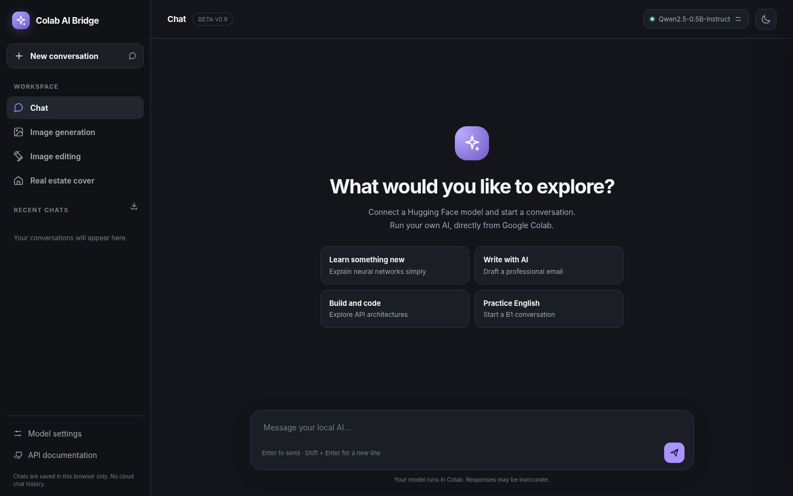

# Colab AI Bridge

A single-cell Google Colab app with a clean, English-language AI workspace. The interface is **inspired by modern chat applications** but has its own design and branding.



> **Beta v0.9:** The user interface, browser workflows, and Python source have been checked locally. Actual model loading on a Google Colab GPU has **not** been end-to-end tested for this release. Large models can take a long time to compile, download, or load.

## Features

- **Chat:** Hugging Face Transformers and single-file GGUF via llama.cpp.
- **Recent chats:** local conversation history in your current browser (up to 35 recently saved conversations, 80 messages each). Export all chats as JSON. This is **not server-side history or synchronization**.
- **Model configuration:** inspect Hugging Face repositories, choose actual GGUF quantization files, set context size, monitor the current loading stage, and view free GPU memory.
- **Image generation:** Diffusers text-to-image for compatible models.
- **Image editing:** compatible Diffusers image-to-image pipelines and reference photo uploads.
- **Real estate cover:** compose 3–6 genuine listing photos with text parsed from your prompt. No imaginary rooms are generated. Supports story, square, portrait, and landscape formats.
- **English UI**, light/dark theme, mobile responsive navigation, integrated REST API and Swagger docs.
- **Password protected:** HTTP Basic or `X-Bridge-Password` authentication, with an ngrok tunnel.

## Quick start — Google Colab

1. Open `dist/Colab_AI_Bridge_v09_one_cell.ipynb` in Google Colab.
2. Select a **GPU** runtime (for example, a Tesla T4).
3. In **Colab Secrets**, add:
   - `NGROK_AUTHTOKEN` — required.
   - `BRIDGE_PASSWORD` — required, at least 12 characters.
   - `HF_TOKEN` — optional, useful for private or gated model repositories you have permission to access.
4. Run the **single code cell**. The launcher installs libraries, creates an isolated Pillow installation when needed, writes the worker, then starts FastAPI and ngrok.
5. Open the printed public URL and authenticate with username `admin` and your `BRIDGE_PASSWORD`.
6. Click **Model settings** to load a compatible model.

### Suggested tests

- **Small chat model:** `Qwen/Qwen2.5-0.5B-Instruct`, task **Chat**, engine **Auto**.
- **Image generation:** `stabilityai/sdxl-turbo`, task **Text-to-Image**, engine **Diffusers**. This model typically uses 512px, 4 steps and guidance 0 for a smoke test.
- **GGUF selection:** supply a Hugging Face repository that contains GGUF files; click **Inspect repository files**, select the actual quantization, and choose the context window. On a T4, avoid assuming a 27B Q3 model will fit in VRAM.
- **Real estate cover:** open that tab, upload 3–6 photos and describe your listing (even without loading an AI model).

Sample property prompt:

```text
For sale · Corporate navy design
Title: Modern 3-bedroom apartment in Selçuklu
Price: ₺4,250,000
Location: Konya / Selçuklu
Features: 145 m² · Elevator · Ensuite bathroom
```

The real estate cover is currently a **deterministic image layout** created with Pillow. It is not a multi-reference generative AI designer. English and Turkish labels are accepted for parsing key property details. Do not use an output for an actual listing without checking the text, photos and property attributes.

## Project structure

```text
colab-ai-bridge/
├── README.md
├── SECURITY.md
├── CHANGELOG.md
├── .gitignore
├── web/
│   └── index.html                 # HTML/CSS/JavaScript UI; no external CDN
├── src/
│   ├── launcher.template.py       # Colab launcher template
│   └── worker.template.py         # FastAPI worker, model loading, APIs
├── tools/
│   └── build_one_cell.py          # Source -> one Python file and one notebook
├── docs/
│   ├── desktop-preview.png
│   └── mobile-preview.png
└── dist/
    ├── Colab_AI_Bridge_v09_one_cell.py
    └── Colab_AI_Bridge_v09_one_cell.ipynb
```

For source modifications, edit `src/` and `web/` and rebuild:

```bash
python tools/build_one_cell.py
```

The build requires only Python's standard library. Generated output is embedded so that end users need only one Colab cell; they do not need to clone the repository in Colab.

## API (selected endpoints)

The web UI and REST API use the same authenticated FastAPI service.

| Method | Route | Purpose |
| --- | --- | --- |
| GET | `/api/health` | Public uptime status only |
| GET | `/api/models/status` | Current model / VRAM / stage |
| GET | `/api/models/inspect?model_id=...` | Discover GGUF files |
| POST | `/api/models/load` | Load chat or image models |
| POST | `/api/chat` | Chat completion |
| POST | `/api/image` | Text-to-image PNG |
| POST | `/api/image-to-image` | Edit a photo; multipart form |
| POST | `/api/estate-cover` | Create property cover; multipart form |
| GET | `/docs` | Interactive API documentation |

See Swagger `/docs` after starting the Bridge for the complete request schemas.

## Model compatibility notes

- **GGUF is not an image generator.** GGUF text models run through llama.cpp in this Bridge. Selecting a specific quantization does not guarantee it fits on your GPU.
- The first GGUF load may compile llama.cpp with CUDA support; allow adequate Colab disk space.
- **Qwen-Image 2.1 is not integrated yet** in v0.9. It requires a special image pipeline and separate VRAM/runtime validation.
- Standard image-to-image is only available when the selected Diffusers pipeline supports it.
- Images are processed in Colab RAM and returned as PNG. The current browser previews are temporary object URLs.

## Privacy and security

- **Never commit secrets to GitHub.** Use Colab Secrets. No token or password should appear in the repository.
- Browser chat history uses `localStorage`; avoid shared devices and delete browser data after use. The Bridge does not upload history to a central history service.
- Your chosen Hugging Face models may download files and their license terms vary. Check licenses before commercial use.
- The Colab notebook is not a permanent hosted server. The ngrok API goes offline when the Colab runtime ends.
- Do not assume ngrok URLs are private; keep the password strong. For serious public deployment, add HTTPS reverse-proxy policies, per-user identity, rate limits, durable storage, and more comprehensive auditing.

## Roadmap

Streaming answers, cancellable/observable GGUF downloads, richer rich-text rendering, template-based listing layouts, optional properly licensed image editors, and deployment outside Colab.

## License

**No license has been selected yet.** Before publishing the repository publicly, the maintainer should choose and add an appropriate `LICENSE` file. Third-party models and libraries have their own independent license terms.
